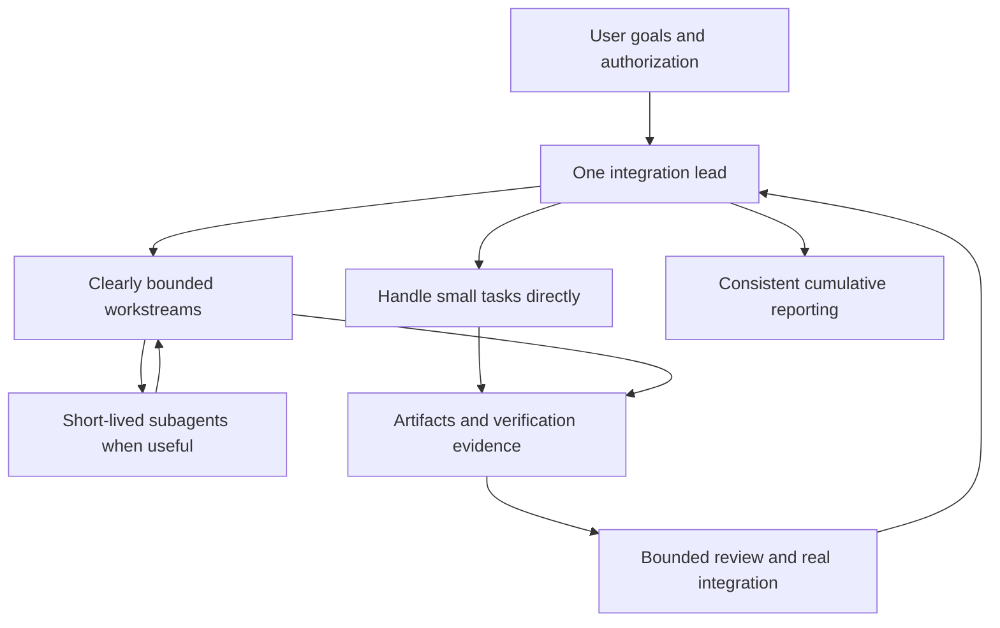

# Project Coordination

A practical skill for clear ownership, bounded delegation, integration review, and consistent progress reporting.

[Chinese overview](README.zh-CN.md)

Use it when a project spans contributors, conversations, milestones, or handoffs. Small tasks stay with one agent. The goal is a coherent, verified result—not more layers of agents.

## Use

Start with [SKILL.md](skills/project-coordination/SKILL.md). Install the `skills/project-coordination` directory through a tool that supports Agent Skills, or ask your agent to read the entrypoint. The optional `agents/openai.yaml` provides Codex interface metadata.

> Use $project-coordination to reconcile this project's requirements, assign clear ownership, and define the next acceptance checkpoint and reporting format. Continue within existing authorization; do not create new standalone chats.

The canonical skill and references are in English. Agents should still communicate in the user's language. The Chinese overview is documentation, not a second set of skill rules.

Review the contents before installing. This package includes no runtime scripts, dependency installer, or configuration hooks.

## Working model

## Coverage

- Inception, mid-project entry, implementation, integration, release, maintenance, and idle periods.
- Trade-offs between a single agent, subagents, persistent workstreams, and independent review.
- Cumulative instructions: preserve omitted requirements and repeated constraints; replace only explicit changes.
- Shared write ownership, interface contracts, architecture, UI consistency, and evidence-based acceptance.
- Bug diagnosis, repeated-failure limits, unknown operations, pause/resume, and lead succession.
- Routine updates, full status tables, exceptions, decisions, and final delivery.
- Task briefs, checkpoints, reviews, bug records, and handoff templates.

Detailed references load only when needed. Existing projects reuse their records rather than adopt a parallel management system.

## Limits

This is a coordination skill, not an agent runtime. It grants no deployment authority and starts no background monitoring. It does not promise a percentage of token savings, zero rework, or official certification.

See [validation](VALIDATION.md), [evaluation scenarios](evaluations/SCENARIOS.md), and [sources](skills/project-coordination/references/sources.md). Report issues with a sanitized scenario, expected behavior, and observed difference; do not upload credentials or user documents.

Version 0.1.1 · MIT License.
