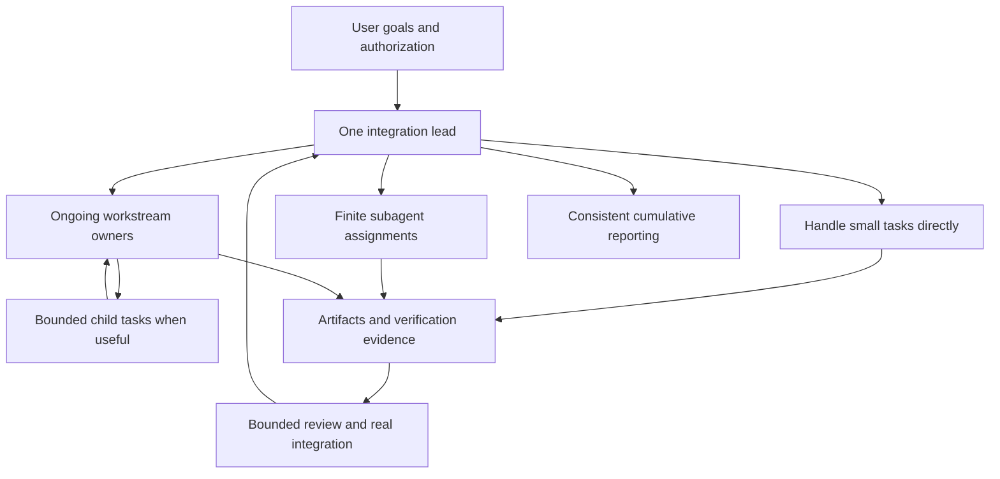

# Project Coordination

A practical guide to keeping a Codex project on track, from the first idea to delivery and maintenance.

[Chinese overview](README.zh-CN.md)

You describe what you want, Codex starts building, and the project grows. Soon there are several conversations, unfinished fixes, new ideas, and people saying their part is done. Someone needs to preserve the full goal, check that the parts work together, and explain what is actually ready.

Project Coordination gives that responsibility a name: the **integration lead**. This is the conversation that keeps the whole project connected. It holds the current requirements, chooses the next useful result, assigns work when that helps, checks the combined outcome, and gives you one coherent report.

Think of it as the project's coordinating brain. It does not need to do every task or retain every implementation detail. It needs to know how the work fits together and what the evidence supports. The current agent can fill this role; a small task needs no extra agents or management files.

The skill provides both the overall architecture and the practical steps: how to start, when to split work, how to supervise it, what to report, and how to recover when the plan stops working. It is useful whether you are directing a project in plain language or already working closely with the code.

## Get started

Start with the short [skill entrypoint](skills/project-coordination/SKILL.md). The [complete operating model](skills/project-coordination/references/operating-model.md) explains the architecture when you want the full picture.

With Node.js and npm available, run this from the project where you want to use the skill:

```sh
npx skills@1.7.2 add Eloiseyt/project-coordination --skill project-coordination --agent codex --copy
```

This uses the third-party [Skills CLI](https://github.com/vercel-labs/skills). It downloads the current repository version and copies it at project scope by default. Review its prompts and proposed paths; omit `--global` to keep the installation within this project. The CLI version is pinned for reproducibility; the skill version is not pinned by that command. See [validation](VALIDATION.md) for what was actually tested.

For a manual or version-pinned installation, download a chosen [GitHub release](https://github.com/Eloiseyt/project-coordination/releases), inspect it, and copy only `skills/project-coordination` into the skill directory supported by your client. In Codex, a project installation can use `.agents/skills/project-coordination`. Follow the current [Codex skills documentation](https://developers.openai.com/codex/skills/) for discovery paths; custom user-wide configurations may differ. Do not overwrite a locally modified copy without comparing and preserving it.

The skill package contains instructions and interface metadata, not runtime code or automatic configuration hooks. The repository's optional Python checker is for maintainers and is not part of the installed skill. An installer is a separate executable tool; inspect that tool too. The Skills CLI supports opting out of telemetry with `DISABLE_TELEMETRY=1`; directory visibility is not a reason to override that choice.

### Confirm it is available

Open a fresh conversation in that project and invoke `$project-coordination`. Ask it to identify the loaded skill and its version, explain its current role, and name the next step without modifying the project. Compare its answer with the installed `SKILL.md` metadata. If it cannot locate the skill, check the actual installation path and your client's discovery settings. A file on disk alone does not prove the client loaded it.

### Start the first session

> Use $project-coordination to lead this project. Establish the complete goal and current state, recommend the smallest useful team, and define the next usable result and reporting format. Keep work within my existing authorization and honor any confirmation steps I request.

For an existing project, provide the location of its current records and work. The lead should verify them and continue from the next unfinished step, without replacing the project's established structure just to match a template.

For a planning conversation, you can say: “Help me organize and improve the requirements first. Let me confirm the architecture before you begin implementation or change the product.” For an approved task, you can say: “Proceed with this plan and verify the result.” The skill distinguishes these requests so planning does not turn into premature execution, and approved work does not stall on repeated permission questions.

The canonical skill and references are in English. Agents should still communicate in the user's language. The Chinese overview is documentation, not a second set of skill rules.

See the [filled walkthrough](examples/first-project.md) for requirements, a bounded assignment, a returned candidate, and the resulting cumulative report. It is an illustrative project, not a claim of measured results.

### Update or go back

Before updating, record the installed version and preserve local edits. For CLI-managed installations, use `npx skills@1.7.2 check` to inspect available updates. Re-running the targeted `add` command updates this selected skill after you review the prompts; `skills update` may affect other managed skills too. Recheck the installed metadata and start a fresh conversation afterward.

For a fixed version or rollback, use the manual release installation above, preserving the current copy first. Restore the chosen skill files only; reverting a skill does not undo project changes already made under its guidance. Release tags identify content, not security certification.

## How the work fits together



The roles differ by responsibility and context lifetime:

| Form | Use it when | What comes back |
| --- | --- | --- |
| Lead works directly | The task is small, closely coupled, or cheaper to do than hand off | A checked result |
| Subagent | A finite investigation, isolated change, or review can be clearly bounded | An artifact, evidence, and limitations |
| Workstream owner, often in a separate chat | A domain needs continuing attention and repeated decisions across milestones | Reviewed progress toward an ongoing outcome |
| Independent reviewer | A consequential decision or complex candidate needs a fresh challenge | Specific findings tied to the actual candidate |

Separate chats are used only when authorized and worthwhile. More contributors create more integration work, so the lead limits active work to what can be reviewed and combined. When tools do not support delegation, one agent can carry the same responsibilities.

## The full project workflow

Plan at three horizons: the overall project, the current stage and next delivery batch, and the tasks that make that batch possible. Keep later work coarse until it becomes relevant. Then repeat one delivery cycle:

1. **Understand the outcome.** Consolidate requirements, improve the framing, and separate commitments from assumptions and suggestions.
2. **Verify the starting point.** Establish what exists, what is unverified, who owns current work, and which operations are still in progress.
3. **Choose the next useful result.** Set boundaries, dependencies, essential interfaces, and evidence needed to finish the batch.
4. **Execute with clear ownership.** Work directly or delegate a complete brief, then let the owner proceed within it.
5. **Review and integrate.** Inspect the return, resolve real findings, and check the complete user path at an identifiable version.
6. **Report and decide.** Present the cumulative state and choose the next action: continue, correct, seek a decision, pause, or deliver.
7. **Improve and continue.** Fix causes of repeated confusion, adjust the organization when needed, and preserve continuity through maintenance or handoff.

New instructions enter this workflow at the relevant point. They do not erase earlier requirements or restart the project by default. A returned task is not automatically an integrated feature; an integrated feature is not automatically released or accepted by the user.

## What is in the skill

| Part of the system | What it explains |
| --- | --- |
| Purpose and organization | Why someone owns the whole outcome; decision rights; when each form of delegation helps |
| Project setup and planning | New and inherited projects; priorities; stages and delivery batches; dependencies and exit conditions |
| Continuous delivery | Dispatch, checkpoint supervision, review, shared writes, interface consistency, and integration |
| Instructions and change | Planning versus execution; confirmation gates; cumulative requirements; scope changes and bug diagnosis |
| State, reporting, and cost | Authoritative records; complete status reports; valid evidence; attention, context, and delegation cost |
| Improvement and continuity | Lead self-review; preventive checks; maintenance; pauses, recovery, and succession |

The [operating model](skills/project-coordination/references/operating-model.md) connects these parts and walks through an example. Focused references and [templates](skills/project-coordination/references/templates.md) supply the procedures. Load them when needed rather than copying the entire package into every assignment.

## What this should feel like in practice

You should be able to ask “Where are we?” and get a clear account of the whole project: what works, what evidence supports that claim, what remains, and who does what next. Contributors should receive enough context to act independently, without inventing incompatible product rules. A small bug should get a bounded diagnosis and fix, not automatically become a redesign.

The lead also reviews its own method. If tasks keep waiting for the same interface, settle it earlier. If finished work arrives faster than it can be integrated, reduce concurrency. If a workstream no longer needs a separate owner, fold it back into direct work. Improving the process can mean removing a layer.

## Limits

This is a coordination skill, not an agent runtime. It grants no deployment authority and starts no background monitoring. It does not promise a percentage of token savings, zero rework, or official certification.

See [validation](VALIDATION.md), [evaluation scenarios](evaluations/SCENARIOS.md), and [sources](skills/project-coordination/references/sources.md). Report issues with a sanitized scenario, expected behavior, and observed difference; do not upload credentials or user documents.

## Maintain and share

Run `python scripts/check_package.py` from a checkout with Python 3.10 or newer. This read-only, standard-library check covers package metadata, local file links, fences, license consistency, and a small set of accidental private markers. It neither runs behavioral exercises nor certifies security. Contribution and release guidance is in [CONTRIBUTING.md](CONTRIBUTING.md); changes are recorded in [CHANGELOG.md](CHANGELOG.md).

Maintained by [Eloiseyt](https://github.com/Eloiseyt). Report a problem through [GitHub Issues](https://github.com/Eloiseyt/project-coordination/issues) with the skill version, a sanitized request, the expected decision, and the observed difference. Do not include credentials, private transcripts, or user documents.

MIT is a permission to use, modify, and redistribute the work under its terms, not an endorsement. Directory listings, installation counts, format checks, and security scans are separate signals. Link any external audit to its provider, date, and reviewed version before displaying a badge. No external certification is claimed.

Version 0.2.1 · [MIT License](LICENSE).
