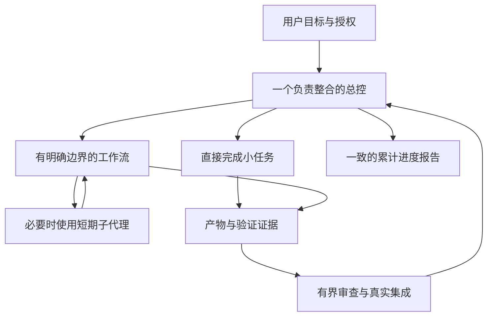

# Project Coordination

为持续进行的项目明确分工、控制共享修改、审查集成结果，并保持一致的进度汇报。

适用于一个负责整合的代理与独立工作流、聊天或子代理协作，也适用于一个代理完成小任务。重点是让功能最终接得起来，而不是增加代理层级。

## 使用

技能入口：[skills/project-coordination/SKILL.md](skills/project-coordination/SKILL.md)。将该目录安装到你所用工具支持的技能位置，或直接让代理读取入口。支持 Agent Skills 格式的工具可使用其中的标准入口；`agents/openai.yaml` 是可选的 Codex 界面元数据。

下载与更新以本仓库发布版本为准。安装前检查内容；技能不附带运行脚本、依赖安装器或自动修改配置的钩子。

示例：

> 使用 $project-coordination 整理这个项目的当前状态，明确谁负责什么、下一个验收节点和汇报方式。已有授权内继续推进；先不要创建新的独立聊天。

小任务直接做；只有存在独立产出、足够信息量或审查风险时，才引入额外执行者。

## 包含什么

- 新项目、中途接手、实施、集成、发布、维护和空档期的节点安排。
- 总控、领域负责人、子代理、审查者的责任，以及各组织方式的代价。
- 单一事实源、共享写入权、接口、代码结构和 UI 一致性审查。
- Bug 定位、连续失败止损、未知操作核实、暂停恢复和总控交接。
- 普通进度、完整总表、异常、授权决定和最终交付的报告规则。
- 按需使用的工单、检查点、审查、Bug 与交接模板。

细则放在参考文件中，入口不要求每次全部读取。已有项目复用原记录，不另建平行管理体系。

## 边界

这是一份协作技能，不是代理运行框架，也不会自动开启后台监督或授予部署权限。它不承诺百分比节省、零返工或官方认证。验证结果见 [VALIDATION.md](VALIDATION.md)，依据见[来源与限制](skills/project-coordination/references/sources.md)。

当前版本：0.1.0。MIT 许可。尚需通过真实项目持续检验；提交问题时请提供经过脱敏的场景、预期行为与实际差异，不上传凭据或用户材料。
