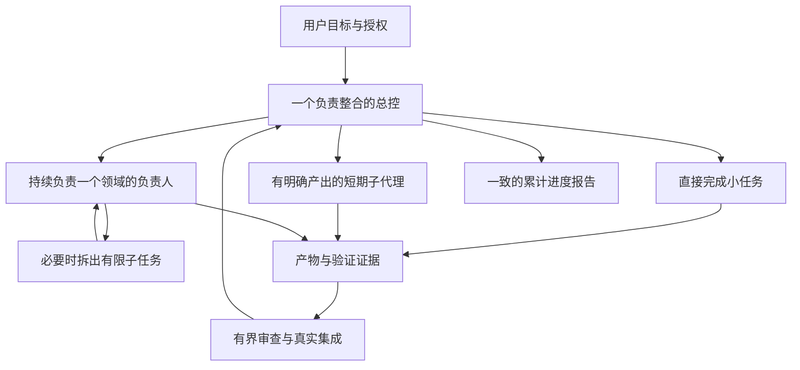

# Project Coordination

[English](README.md)

一份帮助你用 Codex 有条理地完成项目的实用指南，覆盖从最初想法到交付、维护和交接的完整过程。

正式技能入口、规则和模板以英文维护，使用时按用户语言交流；我们使用时仍可用中文。本页是中文说明，不是第二套技能规则。

项目刚开始时，一个聊天往往就够了。随着功能增加，你可能同时讨论设计、修复问题、安排其他聊天实施，还不断补充新要求。这时需要有人记住完整目标，判断下一步先做什么，检查不同部分能否接起来，并向你说明整个项目的真实状态。

这里把这个角色叫作**总控**，英文是 **integration lead**。它负责整体结果，可以由你当前的聊天承担。你也可以把它理解成项目的协调“大脑”：掌握目标、决定、依赖和证据，把各部分连接起来。它不需要亲自做所有事，也不需要知道每一行代码。

这套技能会说明如何建立这种协作方式，以及什么时候根本不需要额外分工。小任务可以由同一个代理完成规划、实施、检查和汇报；只有分工的收益值得承担协调成本时，才增加执行者。无论你主要用自然语言推动项目，还是已经深入参与代码，都可以采用这套方法。

## 使用

技能入口：[skills/project-coordination/SKILL.md](skills/project-coordination/SKILL.md)。将该目录安装到你所用工具支持的技能位置，或直接让代理读取入口。支持 Agent Skills 格式的工具可使用其中的标准入口；`agents/openai.yaml` 是可选的 Codex 界面元数据。

下载与更新以本仓库发布版本为准。安装前检查内容；技能不附带运行脚本、依赖安装器或自动修改配置的钩子。

示例：

> 使用 $project-coordination 担任这个项目的总控。先整理完整目标和实际状态，建议最合适的分工，明确下一项可用成果和汇报方式。保留我要求的确认节点，在已有授权内推进。

如果是已有项目，请提供当前记录和工作位置，总控应核实后接着尚未完成的部分推进。如果还在讨论，可以明确说：“先帮我整理和完善需求，等我确认架构后再正式实施或修改产品。”如果方案已经确认，可以说：“按这个方案实施并验证。”技能会区分这些情况，既避免提前动手，也避免对已批准的步骤反复请示。

完整逻辑见[项目协作架构](skills/project-coordination/references/operating-model.md)。

## 怎样分工

| 形式 | 适用情况 | 应交回什么 |
| --- | --- | --- |
| 总控直接做 | 小任务、紧密相连的修改，或交接比实际处理更费力 | 已检查的结果 |
| 短期子代理 | 有明确终点的调查、独立修改或审查 | 产物、证据、局限和具体发现 |
| 分支聊天中的领域负责人 | 同一领域需要跨多个节点持续判断、保留详细背景 | 经过自身检查的阶段成果及未完成项 |
| 独立审查者 | 重要方案或复杂候选版本需要不同视角检查 | 指向实际版本的具体问题，不另起一套实施方案 |

分支聊天与子代理的主要区别是背景需要保留多久、谁负责持续结果。创建聊天仍需符合实际授权。没有委派工具时，一个代理也可以承担这些职责；多个代理时，则要限制同时进行的工作量，避免结果堆积而无人审查、集成。

## 整个项目怎样推进

规划分三个层次：项目的整体结果、当前阶段与下一批可验收成果、完成这批成果所需的具体任务。近期细化，远期保留方向，不需要一开始猜完所有细节。

之后重复同一个交付流程：

1. **整理目标。** 总结并完善需求，区分已确定要求、待验证假设和可选建议。
2. **核实起点。** 确认已有内容、修改归属、真实证据和仍在运行或结果未知的操作。
3. **选择下一项可用成果。** 明确依赖、边界、必要接口、负责人和退出条件。
4. **实施。** 直接处理，或派发足够清楚的任务；让执行者在约定范围内自主推进。
5. **审查与集成。** 检查实际产物和相关风险，验证不同部分连接后的完整使用路径。
6. **汇报与决定。** 给出累计状态，判断继续、修正、请求决定、暂停或交付。
7. **改进与延续。** 根据真实问题调整协作方式，做好维护、恢复和交接。

新增指令放回这个流程的相应位置，不会默认清空之前的要求。某个聊天交回结果、功能完成集成、正式发布以及用户认可，是不同的状态，需要分别说明。

## 包含哪些内容

| 架构部分 | 主要内容 |
| --- | --- |
| 定位与组织 | 为什么需要总控，职责和决定权限，何时直接做、分支或委派 |
| 项目建立与规划 | 新建和接手，主线、优先级、阶段、交付批次、依赖和退出条件 |
| 持续交付 | 派发、节点监督、共享修改、接口、代码结构、UI 一致性、审查和集成 |
| 指令与变化 | 讨论与执行的区别、确认节点、累计需求、范围变化、Bug 根因定位 |
| 状态、汇报与成本 | 权威记录、累计总表、证据有效性、上下文和委派的实际成本 |
| 改进与延续 | 总控自查、预防性检查、自我迭代、维护、暂停恢复和交接 |

详细流程与[记录模板](skills/project-coordination/references/templates.md)按需读取。已有项目复用原记录，小任务在聊天里保留必要信息即可。

你应当随时能够得到一份连贯的说明：哪些可以用了，依据是什么，还缺什么，谁来做下一步。总控也要检查自己的方法：如果任务总卡在同一个接口，就先解决接口；如果审查积压，就减少并发；如果一个分支不再需要长期保留，就收回直接处理。减少层级也可以是一种改进。

## 边界

这是一份协作技能，不是代理运行框架，也不会自动开启后台监督或授予部署权限。它不承诺百分比节省、零返工或官方认证。验证结果见 [VALIDATION.md](VALIDATION.md)，依据见[来源与限制](skills/project-coordination/references/sources.md)。

当前版本：0.2.0。MIT 许可。尚需通过真实项目持续检验；提交问题时请提供经过脱敏的场景、预期行为与实际差异，不上传凭据或用户材料。
